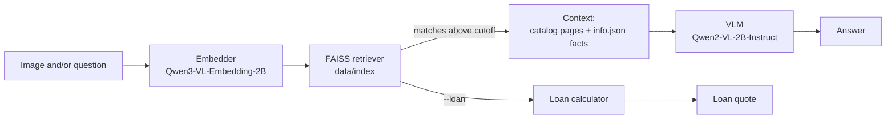

# car-visual-rag

Visual retrieval-augmented generation (RAG) for cars. Give it a car photo, a
text question, or both: it finds the matching model in a local library of
photos and catalog PDFs, then answers with a vision-language model grounded in
that model's catalog facts. It can also quote a car loan for the identified car.

Everything runs locally on two small Qwen models through
[ms-swift](https://github.com/modelscope/ms-swift).

## How it works



1. **Indexing** – every photo and every catalog PDF page (rendered to PNG) is
   embedded and stored in a FAISS inner-product index with its metadata.
2. **Retrieval** – the query image (or, without one, the question text) is
   embedded into the same space and the top matches are returned. Weak matches
   are dropped so an unknown car isn't described with another model's specs.
3. **Generation** – the VLM answers using the image plus the retrieved
   references and the model's `info.json` facts. With no match, it is told to
   say so and describe only what is visible.
4. **Loan** – with `--loan`, the matched model's price feeds a loan
   calculator. The numbers are computed in Python, not generated, and the VLM
   is not loaded.

| Module | Role |
| --- | --- |
| [core/embedder.py](core/embedder.py) | `CarImageEmbedder` – image and text embeddings |
| [core/indexer.py](core/indexer.py) | `CarImageIndexer` – builds and saves the index from `assets/` |
| [core/retriever.py](core/retriever.py) | `CarImageRetriever` – similarity search and model info lookup |
| [core/inference.py](core/inference.py) | `SwiftVLMEngine` – answer generation |
| [core/loan.py](core/loan.py) | Loan calculator (library and CLI) |
| [core/pipeline.py](core/pipeline.py) | `CarVisualRAGPipeline` – ties it together; main CLI |

See [docs/core.md](docs/core.md) for the model architecture.

## Requirements

- Python 3.12 and [uv](https://docs.astral.sh/uv/)
- An NVIDIA GPU. It is developed on a GTX 1060 6 GB (Pascal), which is why
  `pyproject.toml` pins PyTorch to the CUDA 12.6 wheels; newer CUDA builds have
  dropped Pascal support.

## Setup

```bash
uv sync
```

Download both models into `models/` (git-ignored):

```bash
huggingface-cli download Qwen/Qwen2-VL-2B-Instruct --local-dir models/Qwen2-VL-2B-Instruct
huggingface-cli download Qwen/Qwen3-VL-Embedding-2B --local-dir models/Qwen3-VL-Embedding-2B
```

## Adding cars

The library lives in `assets/` (git-ignored), one folder per model:

```
assets/
  <make>/<model>/
    images/       photos (.jpg .jpeg .jfif .png .webp .bmp)
    catalog/      catalog PDFs, one record per page
    info.json     optional catalog facts
```

`info.json` fields are all optional:

```json
{
  "make": "Toyota",
  "model": "GR Yaris",
  "summary": "One-paragraph description.",
  "visual_cues": ["Identifying features the VLM can check in a photo"],
  "specs": {"Engine": "...", "Max power": "..."},
  "catalog_pages": {"1": "What page 1 of the catalog shows"},
  "price": 0,
  "currency": "THB"
}
```

Set `price` to the official price to enable loan quotes without `--price`.

The index is generated into `data/index/` (git-ignored) on the first run.
`info.json` is copied into the index at build time, so **after adding cars or
editing `info.json`, re-index with `--rebuild`**.

## Usage

Run from the repository root.

```bash
# Ask about a photo
uv run python -m core.pipeline --image path/to/car.jpg

# Ask a question about a photo
uv run python -m core.pipeline "What engine does this car have?" --image path/to/car.jpg

# Ask without a photo (retrieval uses the question text)
uv run python -m core.pipeline "What is the fuel tank size of the GR Yaris?"

# Re-index assets/ first
uv run python -m core.pipeline --rebuild --image path/to/car.jpg
```

| Option | Default | Meaning |
| --- | --- | --- |
| `question` | "What car is this? …" | Question to answer |
| `--image` | – | Car photo to ask about |
| `--top-k` | 5 | Records to retrieve |
| `--rebuild` | off | Re-index `assets/` before querying |

The output lists the retrieved records with their scores, then the answer.

### Match cutoffs

Retrieved records below a cosine-score cutoff are dropped
([core/pipeline.py](core/pipeline.py)): **0.78** for image queries and
**0.59** for text queries. They were measured on the GR Yaris data (image
queries: GR Yaris ~0.85+, other cars ~0.71; text: GR Yaris ~0.62+, other cars
~0.56 or lower), so re-check them as the library grows.

## Loan calculator

`--loan` identifies the car, takes its price from `info.json` (or `--price`),
and prints a quote.

```bash
# Identify the car from a photo and quote a loan on its catalog price
uv run python -m core.pipeline --image path/to/car.jpg --loan --down 25% --rate 2.49 --months 72

# Same, with an explicit price
uv run python -m core.pipeline "Toyota GR Yaris" --loan --price 3690000 --down 25% --rate 2.49 --months 72

# Calculator only – no models loaded
uv run python -m core.loan --price 1000000 --down 20% --rate 3 --months 48
```

| Option | Default | Meaning |
| --- | --- | --- |
| `--price` | from `info.json` | Car price; overrides the stored price |
| `--down` | 0 | Down payment: an amount (`500000`) or a share of the price (`25%`) |
| `--rate` | 0 | Annual interest rate, in percent |
| `--months` | 60 | Loan term |
| `--method` | `flat` | `flat` or `amortized` (see below) |

Example output:

```
Price:            1,000,000.00
Down payment:     200,000.00 (20.0%)
Amount financed:  800,000.00
Interest rate:    3% per year (flat)
Term:             48 months
Monthly payment:  18,666.67
Total interest:   96,000.00
Total paid:       1,096,000.00
```

**Interest methods**

- `flat` – the add-on rate used for Thai hire purchase (เช่าซื้อ). Interest is
  charged on the full amount financed for the whole term:
  `interest = financed × rate × years`, `monthly = (financed + interest) / months`.
- `amortized` – a standard reducing-balance loan, as most bank loans work:
  `monthly = financed × r / (1 − (1 + r)^−months)` with `r = rate / 12`.

A flat rate looks lower than the equivalent reducing-balance rate, so compare
offers using the same method.

**Not included:** the 7% VAT that Thai hire-purchase contracts often add to
the interest, insurance, and fees. The monthly payment is not rounded up the
way lenders usually round instalments.

From Python:

```python
from core.loan import calculate_loan, format_quote

quote = calculate_loan(price=1_000_000, down_payment=200_000, annual_rate=3, months=48)
print(format_quote(quote, "THB"))
```

## Limitations

- The 2B VLM can still state details the references don't support; check
  important facts against the catalog.
- Retrieval matches the indexed models only. A car outside the library is
  reported as unrecognised rather than identified.
- The cutoffs above are tuned on a single model and may need adjusting as more
  cars are added.
