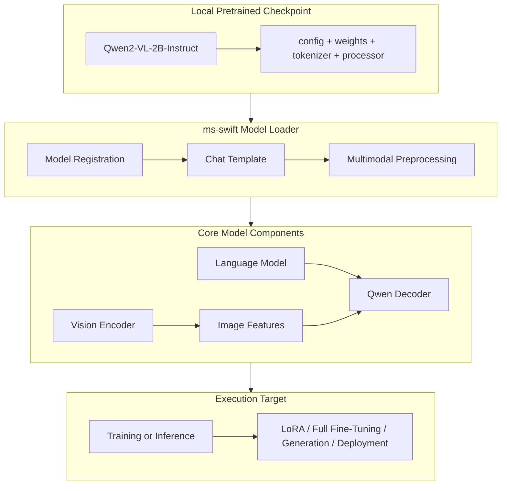

# Core Architecture

## 1. Core Architecture Overview

---

## 2. Key Modules & Workflow

1. **Local Pretrained Checkpoint**
   - **Model**: `Qwen2-VL-2B-Instruct`
   - **Components**: Configuration (`config.json`), safetensors weights, tokenizer, and image processor.

2. **ms-swift Model Loader**
   - Model registration and automated pipeline setup.
   - Chat template application conforming to Qwen multimodal specifications.
   - Multimodal preprocessing (patching, dynamic aspect ratio, image tokens embedding).

3. **Vision Encoder**
   - Processes image inputs to produce high-level **image features** aligned with the textual space.

4. **Language Model**
   - **Qwen Decoder** causal Transformer backbone for multimodal reasoning and text generation.

5. **Training or Inference**
   - **Fine-tuning**: Parameter-efficient training via LoRA / QLoRA, or full fine-tuning.
   - **Deployment**: Inference engines, vLLM / generation pipelines, and API serving.